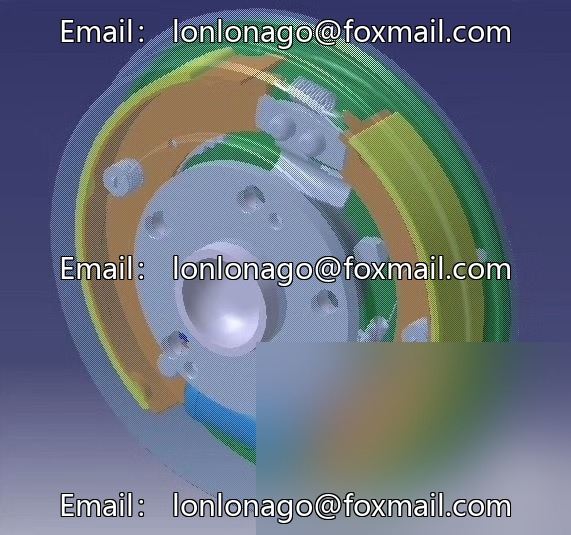
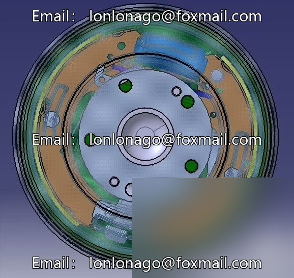

# Drag brake piston structure design; brake customized design

## Body

Drum brake design structure; drum brake custom design; drum brake custom design
Differential gear design
Dromatic brake device count model Dromatic brake device 3D Dromatic brake device data model
Lead-and-tire type drum brake design
Additionally, design can be customized according to your needs.
Multiple models, can be opened and edited with CATIA UG, SolidWorks, etc.
A002 There are other various types of 3D drawings, and services such as modeling and digital model modification, etc., for detailed discussion.

The content covers drum brake structural design, custom brake design, drum brake numeric models, 3D models and data models, with services for modeling and numerical modification available.

<!-- AI_ENRICHED -->

## Images

## Payment

Here is a pay link on Stripe ( https://buy.stripe.com/3cs8yP7sY87d0vu9AB ). Please contact me lonlonago@foxmail.com after funding $89, and I will send you a complete data files , thank you!

